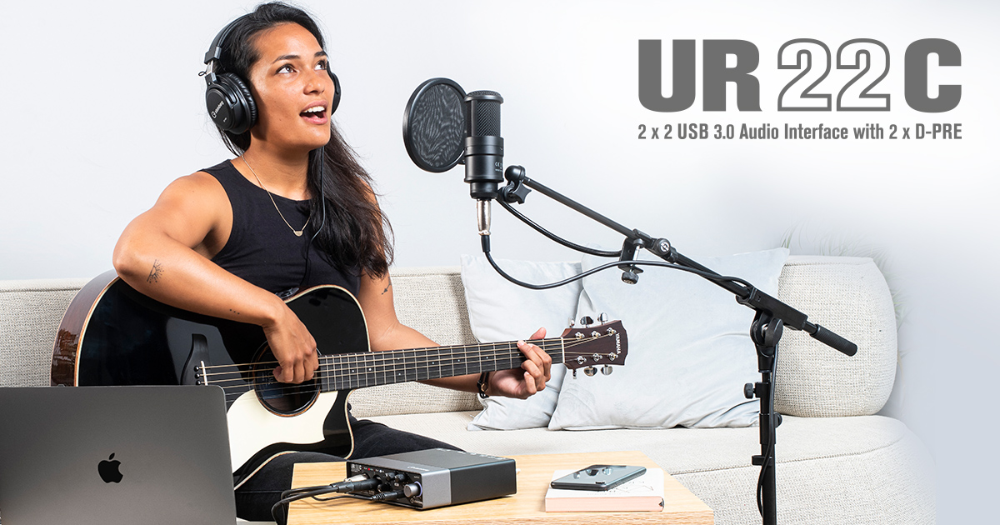
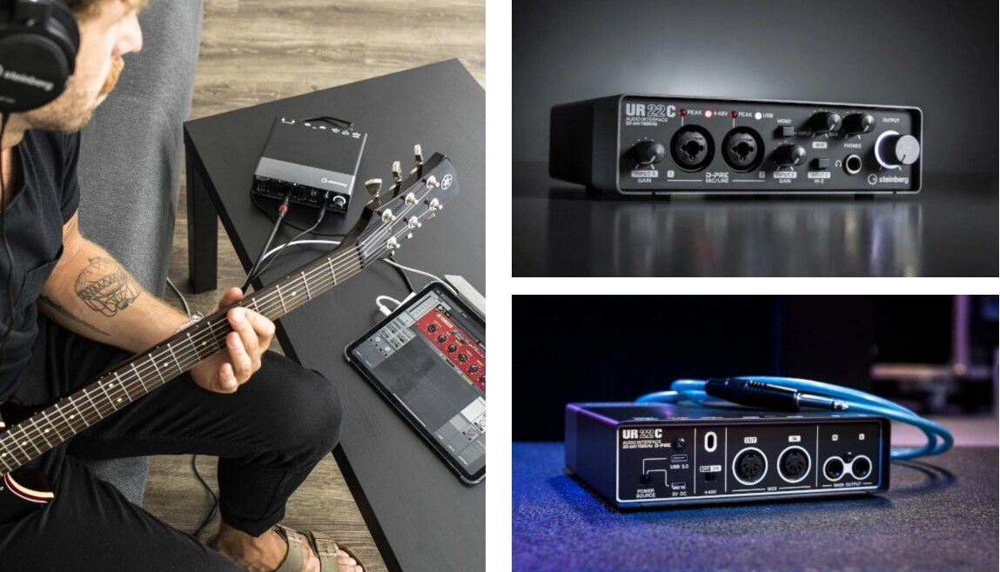
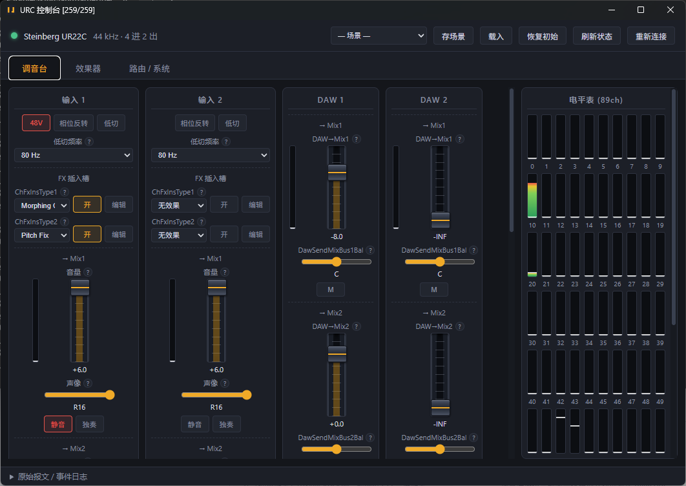
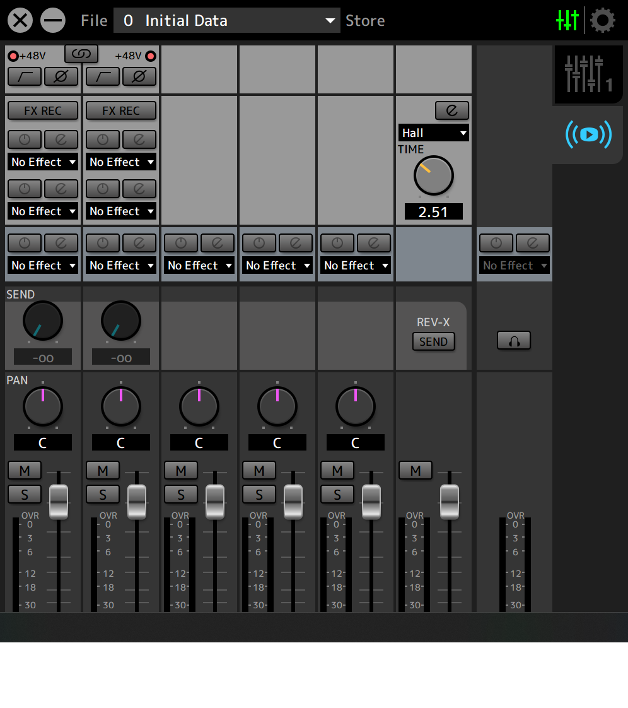
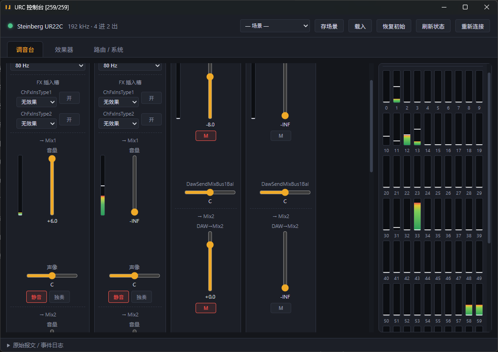
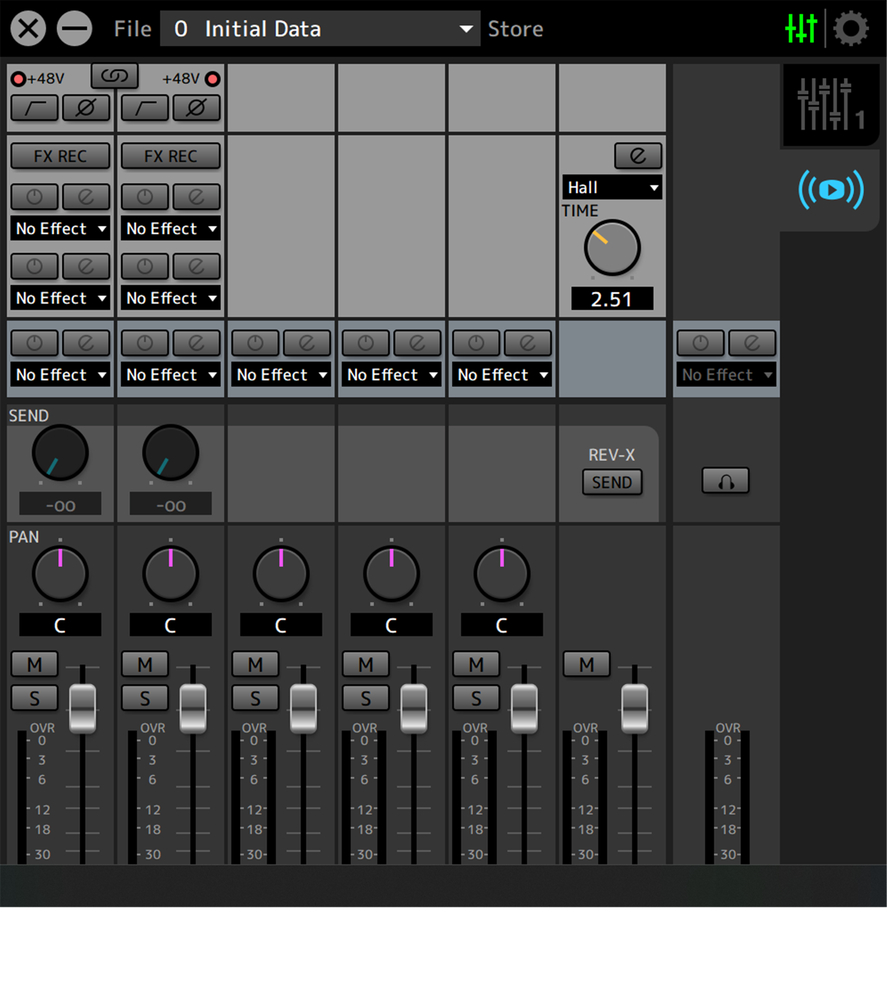
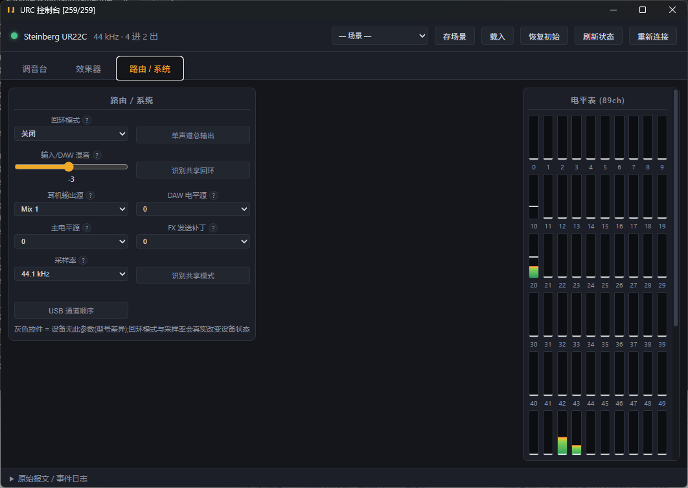

# URC Console — Steinberg UR22C 第三方控制台

**版本**: 0.1.0 · **适用设备**: Steinberg UR22C(兼容 Yamaha UR-C 系列)· **平台**: Windows

URC 控制台(URC Console)是一款第三方开源调音软件,用于替代官方 dspMixFx 对 Steinberg UR22C 声卡进行实时控制。它通过设备驱动提供的 USB Bulk 通道直接读写调音台参数,提供调音台、效果器、路由三个页面,支持场景保存/恢复,并内置 89 通道硬件电平表。

## 仓库结构

| 目录 | 内容 |
|---|---|
| [app/](app/) | URC Console 主程序(Tauri 2 + Rust):UI 在 [app/ui/](app/ui/),后端在 [app/src/](app/src/) |
| [urctl/](urctl/) | SysEx 调试 CLI(开发期协议验证工具) |
| [docs/](docs/) | 本说明引用的界面截图与设备图片 |
| [scripts/](scripts/) | 界面截图 / OCR 辅助脚本 |

安装与构建见下文[「安装与启动」](#2-安装与启动);从 Releases 页面可直接下载 NSIS 安装包。


*UR22C 音频接口(官方产品图,来源:steinberg.net)*

---

## 1. 系统要求

| 项目 | 要求 |
|---|---|
| 操作系统 | Windows 10/11(64 位) |
| 设备 | Steinberg UR22C,通过 USB 连接 |
| 驱动 | **必须先安装 Steinberg 官方 UR-C 系列驱动**(软件借助驱动内置的 ysusb_bulklib64 组件通信;未装驱动时无法发现设备) |
| 权限 | 普通用户权限即可 |

> 其他 UR-C 型号(UR24C / UR44C / UR816C)也能连接,但界面按 UR22C(2 进 2 出)布局,多余的通道条不会显示;不支持本机参数的控件会自动置灰。

### 设备面板速览


*UR22C 面板标注图(来源:steinberg.net 产品页)——正面为两个 Combo 输入(各带 Gain 旋钮与 +48V 开关、输入 2 带 Hi-Z 开关)、MIX 旋钮、+48V 指示灯;背面/侧面为 PHONES 耳机口(带音量旋钮)、USB 3.0 口、5V DC 电源口与 POWER SOURCE 开关*


*UR22C 正面(来源:yamaha.com 产品页)*

> 软件中耳机音量不可调——它由面板上的 **PHONES 音量旋钮**控制(见上文标注图)。

## 2. 安装与启动

### 安装版
运行 `URC Console` 安装包(NSIS),按提示完成安装后从开始菜单启动。

### 开发版(源码运行)
```bash
cd app
cargo tauri dev      # 开发调试
cargo tauri build    # 产出 NSIS 安装包
```

### 启动流程
1. 将 UR22C 用 USB 线连接到电脑(建议直连主板 USB 口,不经过 Hub)。
2. 启动 URC 控制台,软件自动连接设备。
3. 连接成功后软件自动执行一次**批量参数探测**(约 2 秒):向设备逐个查询界面上所有控件的状态。
   - 有应答的控件显示当前值;
   - 无应答的控件变灰并提示"设备无此参数"(型号差异所致,属正常现象)。
4. 窗口标题栏会显示探测结果,如 `URC 控制台 [128/136]`,表示 136 个查询中 128 个有应答。

顶部状态栏含义:
- 🟢 绿点 + 设备名 + `48 kHz · 2 进 2 出`:已连接,并显示设备当前采样率与通道数;
- 🔴 红点 + "未连接":设备未找到或通信失败,按右上角**重新连接**重试。

## 3. 界面总览

实际界面如下(调音台页,右侧电平表栏常驻):


*URC 控制台实际运行截图:顶部为状态栏与场景工具栏,中部为通道条,右侧为 89 通道电平表栏,底部可展开原始报文日志*

- **顶部工具栏**:连接状态、场景管理(存场景 / 载入 / 恢复初始)、刷新状态、重新连接。
- **标签页**:调音台、效果器、路由/系统三个页面。
- **右侧电平表栏**:固定显示 89 通道硬件电平表,随页面切换常驻。
- **底部日志**:点击展开可查看原始 SysEx 报文收发记录(最多保留 300 行),用于调试。

控件类型说明:

| 控件 | 交互方式 |
|---|---|
| 按钮(48V / 静音 / 独奏等) | 点击切换开/关,亮起为开启 |
| 竖直推子 | 拖动调整,拖动停止后立即写入设备,旁边实时显示数值 |
| 水平滑块(声像 / 平衡) | 拖动调整;声像显示为 `C`(居中)/ `L30` / `R30` 等 |
| 下拉框 | 选择档位,选中即写入设备 |

音量类推子的数值以 dB 显示:`-INF`(静音)→ `-74.0` → `0.0` → 最大约 `+10 dB`。

## 4. 调音台页面

布局与官方 dspMixFx 一致,共 7 个通道条:


*URC 控制台调音台页(实时截图)*


*官方 dspMixFx 调音台对照——两版布局一一对应:No Effect 插槽 ↔ FX 插入槽,SEND PAN ↔ → Mix 推子,REV-X SEND ↔ REV-X 发送*

### 4.1 输入 1 / 输入 2(话放通道)
- **48V 幻象电源**:仅"输入 1"通道条上有(UR22C 全局共享 48V,开任一处即全局生效)。使用电容麦克风时开启,动圈麦克风/线路输入请关闭。
- **相位反转**:极性反相,用于处理话筒摆位反相或多话筒串音。
- **低切 + 低切频率**:启用高通滤波,频率可选 40 / 60 / 80 / 100 / 120 Hz,可切掉低频隆隆声。
- **FX 插入槽**(每通道 2 个):相当于官方界面的"无效果"下拉框,可选择将哪种效果器插入该通道:
  `无效果 / Morphing Ch Strip / GA Classics / Comp / Gate / Pitch Fix / Ducker / Maximizer / REV-X`,旁边的"开"按钮控制该插槽启用。
- **→ Mix1 / → Mix2**:该输入信号发送到两条独立监听混音母线的音量推子、声像,以及**静音 / 独奏**按钮(独奏会自动静音其他通道)。推子旁的绿色竖条是该通道实时电平表。

> Mix1/Mix2 是设备内部两条**零延迟监听混音总线**:输入信号(和 DAW 回放信号)在这里混合后送到监听输出。录人声时把直接监听走 Mix1、伴奏走 Mix2,是典型用法。

### 4.2 DAW 1 / DAW 2(DAW 回放通道)
控制电脑 DAW/播放器回放信号进入 Mix1 / Mix2 的音量、平衡和静音。用于调节监听中"伴奏(DAW 回放)与人声(输入直通)"的比例。

### 4.3 Mix1 主控 / Mix2 主控
- **总音量 / 平衡 / 静音**:对应监听总线的主输出。
- **REV-X 发送**:每条总线上的混响返回电平与启用开关,配合效果器页的 REV-X 使用——给通道开 FX 发送后,在这里调节听到的混响量。

### 4.4 监听(耳机)
- **耳机输出源**下拉:选择耳机口监听 Mix 1 还是耳机专用信号(HEADPHONES)。
- **播放源(Windows 端点)**:显示 Music / Voice 两组独立播放端点的电平表(上对 = Music,下对 = Voice),对应驱动的多端点回放通道。
- **注意**:耳机音量由设备面板上的硬件 PHONES 旋钮控制,软件内不调节。

## 5. 效果器页面

按效果器族分面板,全部参数实时写入设备 DSP:


*URC 控制台效果器页(实时截图)——Pitch Fix 与通道 FX 插入槽按输入 1/2 分栏*

| 面板 | 内容 |
|---|---|
| **Sweet Spot Morphing 通道条** | 压缩器(Bypass / Drive / Attack / Release / Ratio / Knee / 阈值偏移 / 补偿增益 / 侧链参数)+ 3 段 EQ(高/中/低频段的启停、频率、增益、Q 值,另有峰值 EQ 增益)+ Morph 变形旋钮(在"Flat/Tube"两种通道特性间连续变形)+ 立体声链接 |
| **REV-X 混响** | 类型(Hall / Room / Plate / Delay)、时间、扩散、初始延迟、高通/低通滤波、房间尺寸、高/低频衰减比、衰减、干湿平衡、低频交点,以及 Mix1/Mix2 发送电平与启停 |
| **Delay 延迟** | 立体声延迟开关、延迟时间、高频比、反馈量 |
| **Guitar Amp Classics** | 放大器类型(CLEAN / CRUNCH / LEAD / DRIVE)、Bypass、噪声门(启停 / 电平 / 范围 / Attack / Hold / Decay) |
| **Pitch Fix**(按输入 1/2 分栏) | 启用、混合电平、主声部移调/共振峰、和声移调/共振峰、和声修正灵敏度、MIDI 控制 |
| **通道 FX 插入槽**(按输入 1/2 分栏) | 各通道插入槽的类型选择与启停 |

官方 REV-X 编辑窗对照(URC 控制台将相同参数整合进了 REV-X 面板):


*官方 dspMixFx 的 REV-X(Hall)编辑窗对照*

使用提示:
- 想给输入通道挂混响:先在"调音台"页把该通道的 **FX 发送**或插入槽设为 REV-X 并启用,再到本页调 REV-X 参数,最后在 Mix 主控的"REV-X 发送"里调返回量。
- 探测后显示灰色的参数表示设备固件不支持,不可调。

## 6. 路由 / 系统页面

集中放置全局路由与系统参数:


*URC 控制台路由/系统页(实时截图)*

| 参数 | 说明 |
|---|---|
| **回环模式** | `关闭 / 仅 DAW / 仅 AUX / DAW + AUX`。将输入信号回录进 USB(直播、录系统声等场景使用) |
| **单声道总输出** | 将总输出合为单声道 |
| **输入/DAW 混音** | 切换硬件监听为"输入直通"或"DAW 回放"为主的路由 |
| **识别共享回环 / 识别共享模式** | Loopback 与识别(RECN share)相关的兼容开关 |
| **耳机输出源** | 同调音台"监听"栏(路由页为 0–3 档原始值) |
| **DAW 电平源 / 主电平源** | 选择电平表显示哪路信号 |
| **FX 发送补丁** | FX 发送路由补丁 |
| **采样率** | 44.1 / 48 / 88.2 / 96 / 176.4 / 192 kHz。**切换会真实改变设备时钟**,正在放音/录音的 DAW 需同步切换工程采样率,否则可能无声或变调 |
| **USB 通道顺序** | 改变 USB 音频通道排列 |

> ⚠️ 页面内注明:**回环模式与采样率会真实改变设备状态**。修改前请确认 DAW 未在录音/播放关键任务中。

## 7. 电平表(右侧栏)

- 设备硬件电平数据由驱动主动推送,共 **89 个通道**,以"当前电平 + 峰值保持"双指标竖条显示。
- 悬停任意通道可查看原始值与换算 dB(0 dBFS = 8191)。
- 关键通道映射:

| 通道 | 含义 |
|---|---|
| 0–1 | 输入 1 / 输入 2 |
| 6–7 | DAW 回放 1 / 2 |
| 10–13 | Mix1 L/R、Mix2 L/R 主输出 |
| 14–19 | 压缩器增益衰减(GR) |
| 20–25 | EQ 段 |
| 30–33 | REV-X 返回 / 发送 |
| 52–53 | 监听总线(耳机回放路径) |
| 54–57 | Music / Voice 播放端点 |

各通道条旁的小电平表显示同一数据的对应通道。

## 8. 场景管理

顶栏右侧三个按钮 + 下拉框:

| 操作 | 说明 |
|---|---|
| **存场景** | 把当前所有已读取状态的参数打包保存,自动命名 `场景-日期-时间`(如 `场景-20261124-153000`),保存到 `%APPDATA%\URC Console\scenes\*.json`,可手动改名 |
| **载入** | 下拉框选择场景 → 点"载入",逐项写回设备,控件同步刷新;写入失败的项会弹 toast 提示 |
| **恢复初始** | 将界面上全部控件写回参数表**出厂默认值**(并非设备备份恢复;不覆盖参数表之外的状态) |

场景文件为 JSON,包含参数 ID、通道号与数值,可手动编辑或跨机器复制。
载入场景前建议先用"存场景"保存当前状态,便于回退。

## 9. 故障排除

| 现象 | 处理 |
|---|---|
| 顶部红点"未连接" | 1) 确认 USB 线与接口(换线/换口);2) 确认已装 Steinberg UR-C 驱动;3) 检查设备是否被其他程序独占;4) 点"重新连接" |
| 刚才还连着,突然显示"设备插拔,请重连" | 设备 USB 断开过(休眠/Hub 断电等),重新插稳后点"重新连接" |
| 探测结果数量很少(如 `[3/136]`) | 设备忙或通信不稳;点"刷新状态"重试 |
| 控件灰色,提示"设备无此参数" | 该型号固件不含此参数,属正常;其他 UR 系列型号上会更多 |
| 操作弹出 toast 报错"参数 0x… 无应答" | 查询超时,设备未回复该参数;点"刷新状态"重试 |
| 电平表不动 | 电平推送依赖保持连接的轮询;若长时间无推送,点"重新连接"重建会话 |
| 修改采样率后 DAW 无声 | DAW 工程采样率与设备不一致,在 DAW 中同步切换 |
| 场景载入后部分项报"写 xx 失败" | 该项是其他型号/其他会话留下的参数,设备不接受,可忽略或删掉场景 JSON 中对应项 |
| 想看底层通信 | 展开"原始报文 / 事件日志",RX 开头行即设备发来的 SysEx |

## 10. 已知限制

- 本软件为逆向工程产物,未经 Yamaha/Steinberg 官方认证;写入的参数范围来自官方驱动参数表,但个别组合行为可能与官方软件有差异。
- 每次修改立即写入设备,**没有撤销功能**;重要状态请先"存场景"。
- 不支持官方软件的预设库管理、DSP 组件安装等功能。
- 同时运行官方 dspMixFx 可能与本软件争抢设备会话,建议二选一。

## 附录:urctl 命令行调试工具

仓库中的 `urctl/` 是开发期的 SysEx 传输验证工具(走 MIDI 口,与主程序走 Bulk 口不同),供调试协议用:

```text
urctl list              枚举所有 MIDI 端口(* = Yamaha/Steinberg)
urctl monitor [filter]  监听匹配的 MIDI IN 端口,实时打印 SysEx
urctl send <idx> <hex>  向 OUT 端口 <idx> 发送原始字节
urctl identity [filter] 发送通用身份请求并捕获 4 秒内的应答
```

普通用户无需使用。
